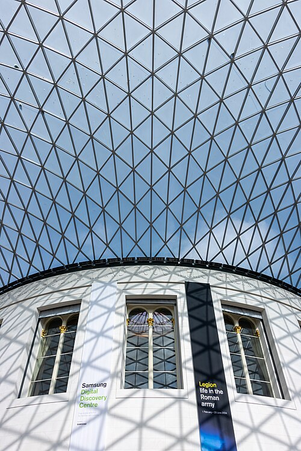
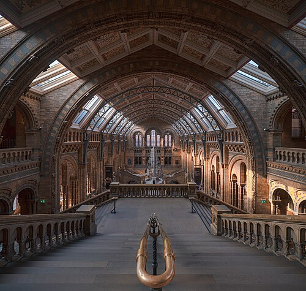
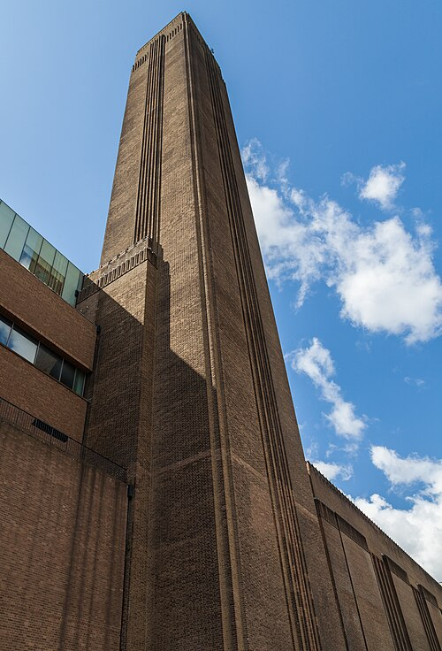
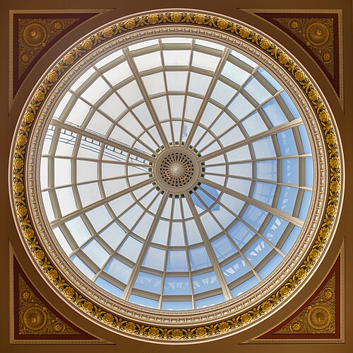
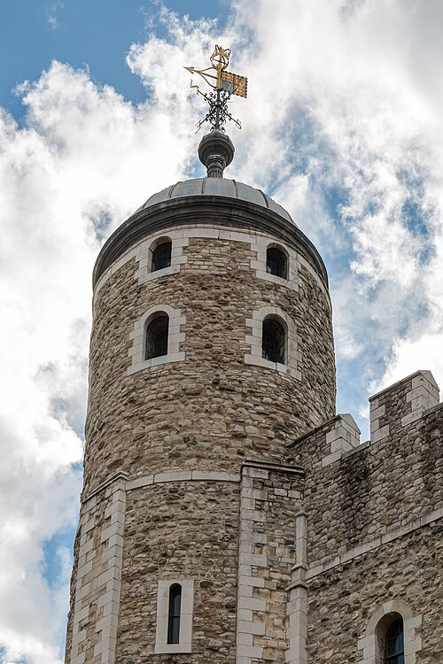

Welcome to London! Discover **world-class museums**, historic landmarks and *vibrant neighbourhoods* in one of the world's great cities.

```{python}
#| echo: false
import pandas as pd

attractions = pd.read_csv("data/attractions.csv")
top = attractions.loc[attractions["visits_2025"].idxmax()]
total = int(attractions["visits_2025"].sum())
```

In 2025, the most visited attraction was the `{python} top["attraction"]` with `{python} f"{int(top['visits_2025']):,}"` visits; the attractions in `data/attractions.csv` had `{python} f"{total:,}"` visits in total (ALVA member attractions).

```{python}
#| label: fig-top10
#| echo: false
#| fig-cap: "Visits in 2025 to ALVA member attractions in London (source: ALVA, data/attractions.csv)."
#| fig-alt: "Horizontal bar chart of 2025 visits to ten London attractions, longest bar at the top: the Natural History Museum is highest."
import matplotlib.pyplot as plt

d = attractions.sort_values("visits_2025")
fig, ax = plt.subplots(figsize=(8, 4.5))
ax.barh(d["attraction"], d["visits_2025"] / 1e6)
ax.set_xlabel("Visits in 2025 (millions)")
plt.tight_layout()
plt.show()
```

## Five sights to start with

1. British Museum
2. Natural History Museum
3. Tate Modern
4. National Gallery
5. Tower of London

## Getting around

- 🚇 Tube
- 🚌 Bus
- 🚲 Santander Cycles

## Plan your visit

Plan your journey with the [TfL Journey Planner](https://tfl.gov.uk/plan-a-journey/).

.](images/big-ben.jpg){width=30% fig-alt="The clock tower of the Palace of Westminster, known as Big Ben, seen against the sky."}

### Tip from a local

> Walk along the Thames at sunset: the views from the South Bank are free and unforgettable.

## Sights at a glance

| Photo | Sight | Price band | Nearest tube | More |
|:--|:--|:--|:--|:--|
| {height=60} | British Museum | Free | Tottenham Court Road | [Read more](https://www.britishmuseum.org/visit) |
| {height=60} | Natural History Museum | Free | South Kensington | [Read more](https://www.nhm.ac.uk/visit.html) |
| {height=60} | Tate Modern | Free | Southwark | [Read more](https://www.tate.org.uk/visit/tate-modern) |
| {height=60} | National Gallery | Free | Charing Cross | [Read more](https://www.nationalgallery.org.uk/visiting) |
| {height=60} | Tower of London | Paid | Tower Hill | [Read more](https://www.hrp.org.uk/tower-of-london/visit/) |

: Five London sights. Price bands from [ALVA](https://www.alva.org.uk/details.cfm?p=423) (visits to ALVA member attractions, 2025); nearest tube stations and pages from each attraction's official visitor page (National Gallery: [TfL Unified API](https://api.tfl.gov.uk/StopPoint/?lat=51.50893020629883&lon=-0.12829899787902832&stopTypes=NaptanMetroStation&radius=800)). Full sources in `data/sights.csv`. Photos: British Museum, Mike Peel (CC BY-SA 4.0); Natural History Museum, Julian Herzog (CC BY 4.0); Tate Modern, Diego Delso (CC BY-SA 4.0); National Gallery, Diego Delso (CC BY-SA 4.0); Tower of London, Dietmar Rabich (CC BY-SA 4.0), all via Wikimedia Commons; see `images/ATTRIBUTION.md`.

## Before you go

```text
[ ] Check opening times on each official page
[ ] Plan your route with the TfL Journey Planner
[ ] Bring an Oyster card or contactless payment
```
